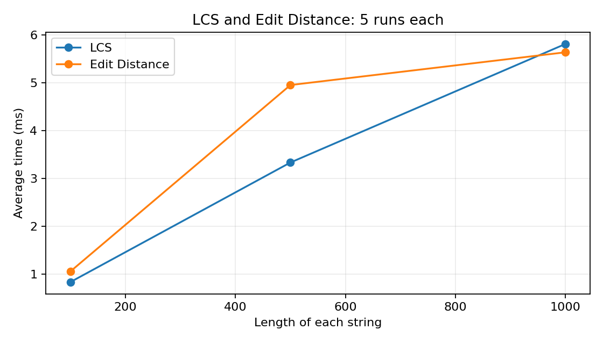
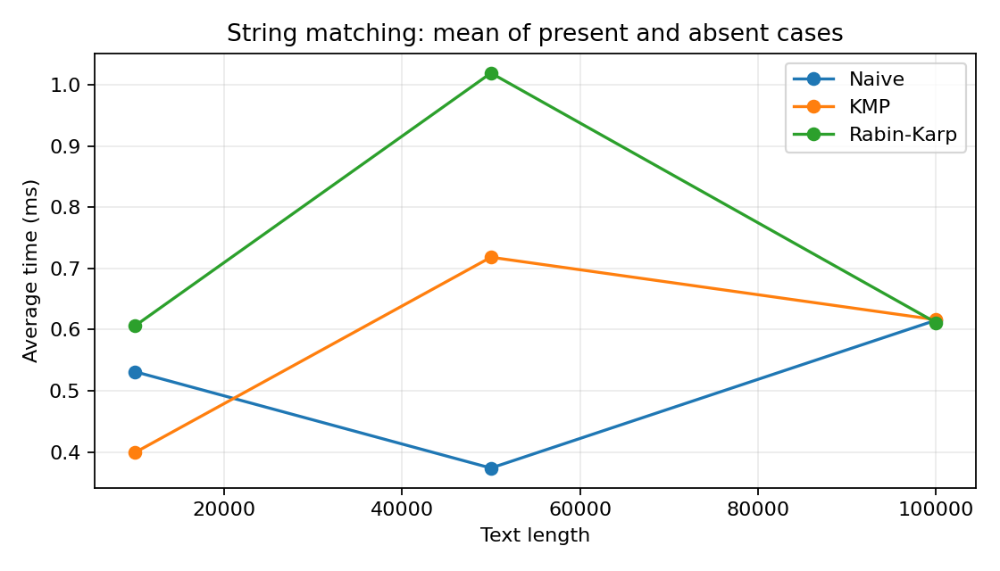

# Assignment 4 — Text Analysis: Dynamic Programming and String Algorithms

## 1. Problem description and algorithm overview

This Java project implements six algorithms:

- **LCS:** longest shared subsequence length.
- **Edit Distance:** minimum insertions, deletions, and substitutions.
- **Naive:** checks every possible match position.
- **KMP:** uses an LPS array to avoid repeated comparisons.
- **Rabin–Karp:** searches with a rolling hash and verifies matches.
- **Kasai:** finds the common prefix lengths of neighboring suffixes from a given suffix array (`LCP[0] = 0`).

## 2. Implementation decisions and assumptions

The code uses basic Java. LCS and Edit Distance use DP tables; KMP uses LPS; Rabin–Karp uses base `31`, modulus `1000000009`, and checks matching hashes. Kasai takes a valid suffix array.

Search is case-sensitive with 0-based indices. An empty pattern matches at every index from `0` to `text.length()`. Inputs are not null. Match lists take `O(k)` extra space for `k` matches, not counted as auxiliary space.

Compile and run from the project folder with a JDK:

```sh
javac Main.java Tests.java
java Tests
java Main
```

## 3. Complexity analysis table

Here, `n` and `m` are the two string lengths (or text and pattern lengths for matching).

| Algorithm | Main recurrence or operation | Preprocessing | Best time | Worst time | Auxiliary space | Reason |
|---|---|---|---|---|---|---|
| LCS | Equal: `1 + dp[i-1][j-1]`; else: `max(dp[i-1][j], dp[i][j-1])` | — | O(nm) | O(nm) | O(nm) | Every table cell is filled once. |
| Edit Distance | Equal: `dp[i-1][j-1]`; else: `1 + min(delete, insert, replace)` | — | O(nm) | O(nm) | O(nm) | Every table cell is filled once. |
| Naive | Compare pattern from every starting position | O(1) | O(n) | O(nm) | O(1) | A mismatch may happen immediately or after `m` characters. |
| KMP | Use LPS to move pattern index after a mismatch | O(m) | O(n+m) | O(n+m) | O(m) | The text is scanned without restarting, and LPS is built once. |
| Rabin–Karp | Update a rolling hash and verify matching hashes | O(m) | O(n+m) | O(nm) | O(1) | Updating each window hash is O(1); many matches or collisions need O(m) checks each. |
| Kasai | Compare neighboring suffixes; reuse previous prefix length | O(n) for rank array | O(n) | O(n) | O(n) | The matched length is reused, so total comparisons stay linear. |

LCS starts with zeros for empty prefixes. Equal characters add 1; otherwise, skipping a character gives the best shorter answer. Edit Distance starts with `dp[i][0] = i` and `dp[0][j] = j`; it takes the cheapest insertion, deletion, or substitution. Both recurrences build correct answers from smaller prefixes.

KMP uses LPS after a mismatch, so it does not restart comparisons. Rabin–Karp checks characters when hashes match to handle collisions; its expected time is `O(n+m)`, but the worst case is `O(nm)`. These bounds are theoretical, not measured times.

## 4. Testing strategy and results

**30/30 checks passed** with `java Tests`:

- **LCS:** identical, different, and empty strings.
- **Edit Distance:** identical, empty, substitution, insertion, and deletion.
- **Matching:** beginning, middle, end, multiple/overlapping matches, absent, longer-than-text, and empty pattern. All three algorithms returned the same expected indices.
- **Kasai:** `banana`, verified suffix array `[5, 3, 1, 0, 4, 2]` and LCP `[0, 1, 3, 0, 0, 2]`.

## 5. Experimental setup, input sizes, and timing methodology

`Main` uses `Random(42)`, alphabet **`abcd`**, **5 runs** per case, and average milliseconds from `System.nanoTime()`. Input generation, suffix-array sorting, checks, and output are outside the timed code.

- **LCS/Edit Distance:** two strings of lengths **100, 500, 1000** (same pairs).
- **Matching:** texts of **10000, 50000, 100000**; patterns of length **12**, both present and absent. All three algorithms use identical inputs; absent patterns are checked before timing.
- **Kasai:** strings of **1000, 5000, 10000** with suffix arrays built before timing.

Matching operation counts are character comparisons and hash checks recorded from one run.

## 6. Tables and plots of experimental results

**LCS and Edit Distance** — average milliseconds:

| Algorithm | String length | Average time (ms) |
|---|---:|---:|
| LCS | 100 | 0.838654 |
| Edit Distance | 100 | 1.061169 |
| LCS | 500 | 3.333353 |
| Edit Distance | 500 | 4.950617 |
| LCS | 1000 | 5.807283 |
| Edit Distance | 1000 | 5.634104 |



**String matching** — average milliseconds, character comparisons, and window hash checks:

| Algorithm | Text length | Pattern | Average time (ms) | Character comparisons | Hash checks |
|---|---:|---|---:|---:|---:|
| Naive | 10000 | present | 0.827854 | 13355 | 0 |
| KMP | 10000 | present | 0.461791 | 12463 | 0 |
| Rabin-Karp | 10000 | present | 0.623591 | 12 | 9989 |
| Naive | 10000 | absent | 0.234721 | 13294 | 0 |
| KMP | 10000 | absent | 0.335755 | 12549 | 0 |
| Rabin-Karp | 10000 | absent | 0.588131 | 0 | 9989 |
| Naive | 50000 | present | 0.470930 | 66512 | 0 |
| KMP | 50000 | present | 1.117126 | 62373 | 0 |
| Rabin-Karp | 50000 | present | 1.528619 | 12 | 49989 |
| Naive | 50000 | absent | 0.276248 | 66701 | 0 |
| KMP | 50000 | absent | 0.319628 | 62468 | 0 |
| Rabin-Karp | 50000 | absent | 0.510569 | 0 | 49989 |
| Naive | 100000 | present | 0.513022 | 133440 | 0 |
| KMP | 100000 | present | 0.607311 | 123359 | 0 |
| Rabin-Karp | 100000 | present | 0.634481 | 12 | 99989 |
| Naive | 100000 | absent | 0.717847 | 133426 | 0 |
| KMP | 100000 | absent | 0.625063 | 125013 | 0 |
| Rabin-Karp | 100000 | absent | 0.588342 | 0 | 99989 |



The matching plot uses the average of present and absent times for each text length.

**Kasai** — average milliseconds:

| String length | Average time (ms) |
|---:|---:|
| 1000 | 0.120618 |
| 5000 | 0.585709 |
| 10000 | 0.823652 |

## 7. Discussion comparing theoretical and experimental results

DP times generally grew with input size, as expected for `O(nm)`. Naive matching was often fast for short patterns; KMP has better worst-case time, while Rabin–Karp spends time on hashing. Some timing variation is normal in Java. Kasai increased from `0.120618` to `0.823652` ms as length grew from 1000 to 10000, consistent with `O(n)`. Big-O does not predict exact timings.

## 8. Conclusion identifying the main trade-offs between the algorithms

LCS and Edit Distance are simple but use `O(nm)` memory. Naive is simplest but can be slow; KMP uses LPS memory for linear search. Rabin–Karp needs collision checks. Kasai is linear when a suffix array is given.
